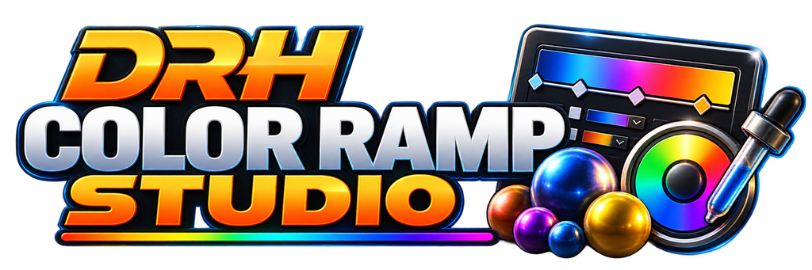
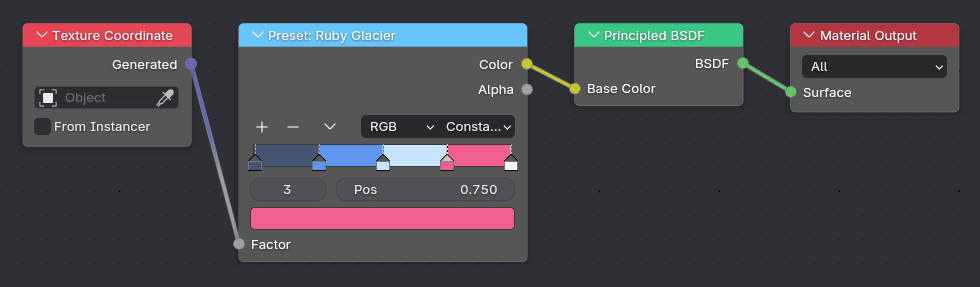

# DRH - Color Ramp Studio

**A color ramp that takes twelve clicks today takes one. And you keep the stops editable.**

   

  

## The wall

You have a reference image, a brand palette, or a mood in your head. Blender gives you two stops and a slider. Getting from that to a ramp you actually like means adding stops one at a time, guessing at hex values, and rebuilding the whole thing when the client says "warmer."

Color Ramp Studio 1.1.0 shortens that loop. Build a ramp from a preset, an image, or a screen sample, edit it in sRGB where your eyes work, and convert it into a node group when you need to reuse it. Convert back to a native ramp whenever you want, which matters if you've ever been handed a .blend full of nested groups you didn't make.

## What's in it

**Presets you can filter, not scroll.** Category, text search, and dominant color family stack together. There's a dedicated Grayscale category, and the library got curated in 1.1.0 to drop families that looked the same as each other.

**Sampling that doesn't invent colors.** Point at an image or a screen region and get a usable ramp. Image handling runs on a temporary datablock the add-on owns, with bounded pixel sampling, and the sRGB to linear conversion happens on an explicit pipeline instead of by accident.

**Editing that understands color.** Hue, saturation, harmony, and temperature style moves happen in sRGB-aware space before values return to Blender's linear RGB. Stops can be copied, pasted, reversed, normalized, redistributed, randomized, simplified, sorted, mirrored, rotated, nudged, or refined one at a time.

**Conversion with a way back.** Ramps convert into editable group-based setups and restore to native ramps. Cleanup after a failed conversion is transactional, so a bad pass doesn't leave orphaned nodes in your tree.

**Alpha handled like color.** Set a uniform alpha, build an alpha gradient, and keep alpha edits through conversion.

Works across Shader Editor, Geometry Nodes, and Compositor wherever the node types exist. New ramps land at the center of your visible canvas instead of wherever the node cursor happened to be pointing.

## Who it's for

Material artists who build ramps all day. Technical artists who need ramps generated to a rule instead of by feel. Anyone handed a shader file by someone else and told to "just tweak the colors."

## Get it

Free on BlendKit. Blender 4.2 or newer.

Changelog: [CHANGELOG.md](CHANGELOG.md) · Manual: [docs](docs) · Bugs and requests: [open an issue](https://github.com/pacosalasv/DRH_Color_Ramp_Studio-Support/issues)

A rating on BlendKit puts this in front of the next artist searching for it.

  

